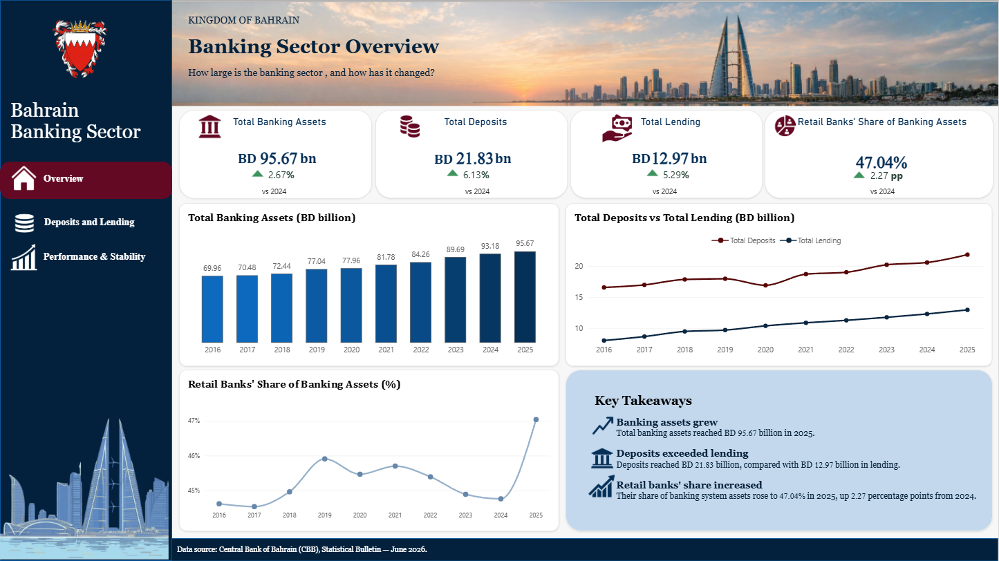
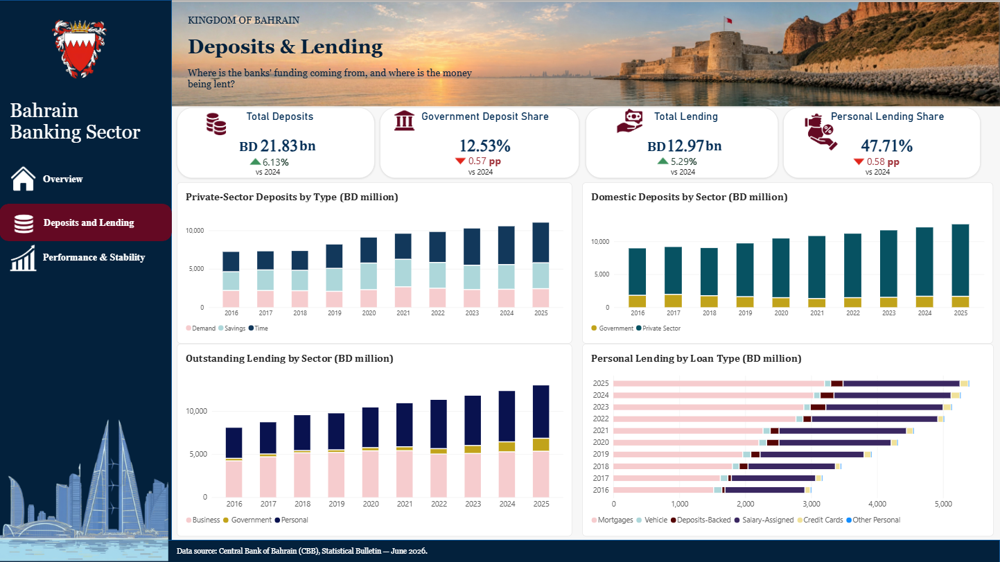
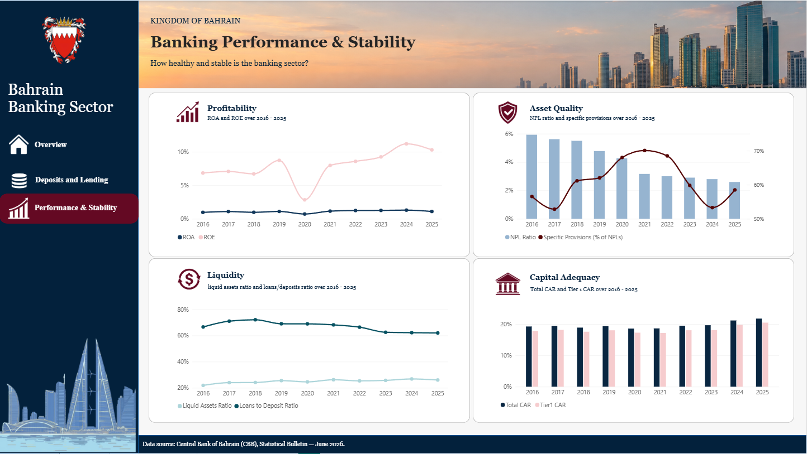

# Bahrain Banking Sector Analysis

A data analytics project exploring Bahrain's banking sector using Python, Excel, and Power BI. The repository includes the analysis script, a supporting workbook, an interactive Power BI report, and dashboard screenshots.

## Project at a glance

- **Sector:** Banking and financial services
- **Geography:** Bahrain
- **Tools:** Python, Power BI, Microsoft Excel
- **Analysis areas:** Banking sector overview, deposits and lending, performance and stability

## Dashboard preview

### Banking overview

### Deposits and lending

### Performance and stability

## Repository contents

| File or folder | Description |
|---|---|
| `BahrainBankingSector.pbix` | Power BI report |
| `BahrainBankingSector.py` | Python analysis script |
| `Jun-2026.xlsx` | Supporting Excel workbook |
| `screenshots/` | Images of the Power BI report |

## Project objectives

- Explore indicators that describe the Bahrain banking sector.
- Examine deposits and lending activity.
- Review selected measures of banking performance and stability.
- Present the analysis in a clear, visual Power BI report.

## Tools and technologies

- **Python** — data preparation and analysis.
- **Microsoft Excel** — supporting data workbook.
- **Power BI** — interactive data visualisation and reporting.

## How to view the project

1. Open `BahrainBankingSector.pbix` using Microsoft Power BI Desktop to explore the report.
2. Review `BahrainBankingSector.py` for the Python analysis.
3. See the `screenshots/` folder for static previews of the dashboard.

## Data source and methodology

Add the original data source(s), publication links, coverage dates, and any transformations or assumptions used in the analysis here. Make sure the workbook is suitable for public redistribution before publishing it in this repository.

## Key findings

Add 3–5 findings supported by your analysis here. Include the relevant metric, time period, and comparison so readers can understand what the results show. Avoid adding conclusions that are not directly supported by the data.

## Disclaimer

This repository is for educational and portfolio purposes. The analysis is not investment advice and should not be treated as an official assessment of any financial institution.
